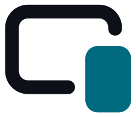
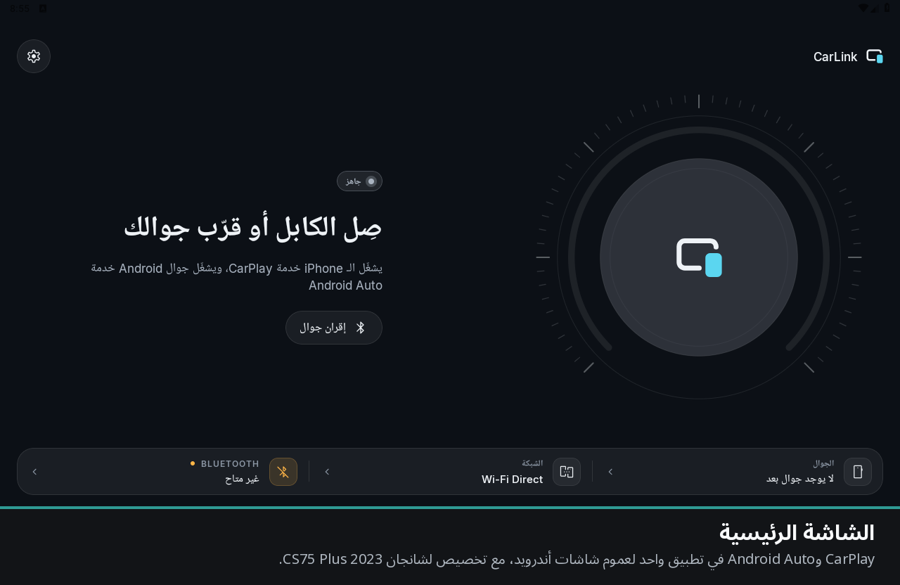
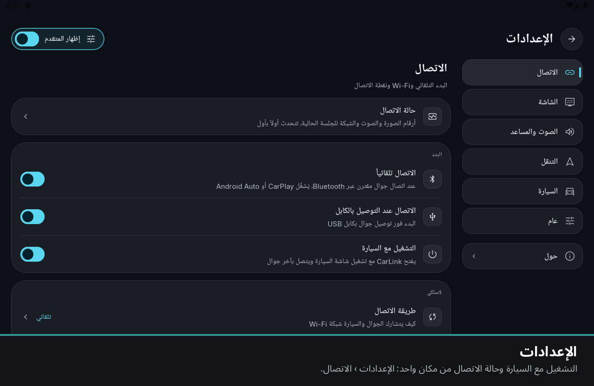
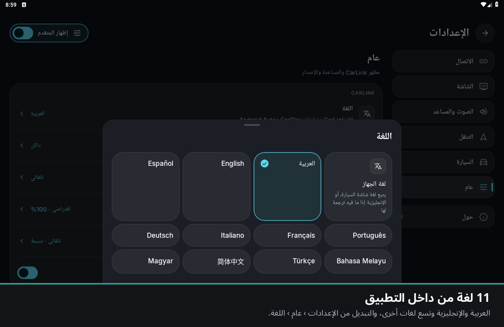
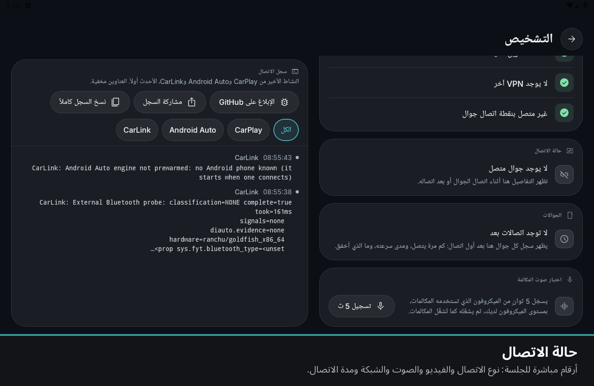
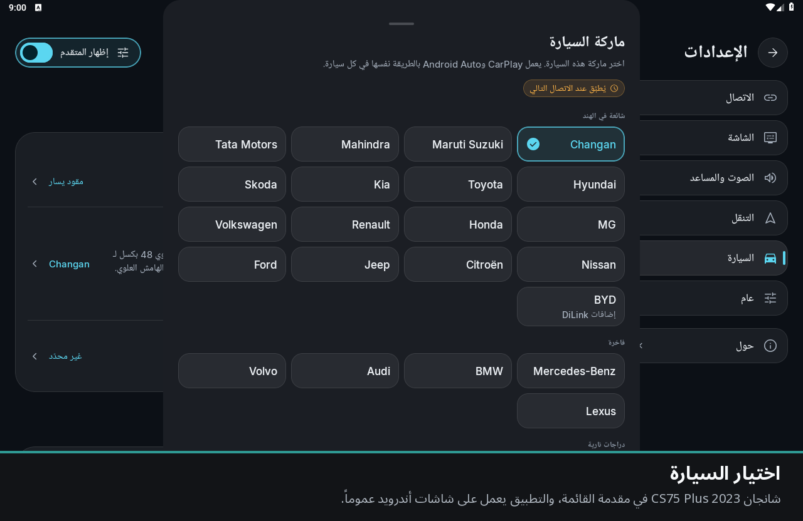
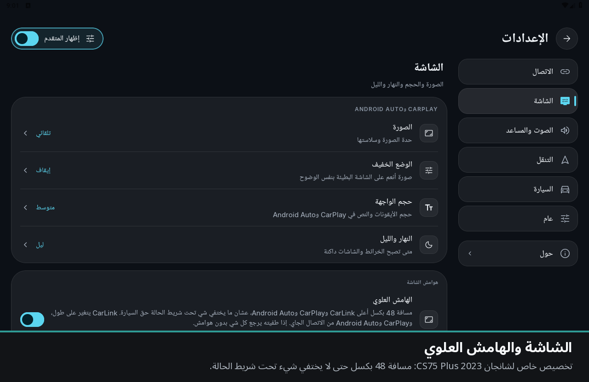

<picture>
  <source media="(prefers-color-scheme: dark)" srcset="docs/assets/carlink-mark-dark.svg">
  <source media="(prefers-color-scheme: light)" srcset="docs/assets/carlink-mark-light.svg">
  
</picture>
&nbsp;&nbsp;&nbsp;

# CarLink

**CarPlay و Android Auto في تطبيق واحد لعموم الشاشات العاملة بنظام أندرويد، مع دعم وتخصيص خاص لشاشة شانجان CS75 Plus 2023.**

**CarPlay and Android Auto in one app for Android car head units in general, with dedicated support and tuning for the Changan CS75 Plus 2023 head unit.**

[**التحميل / Download**](https://github.com/0nezar0/carlink-releases/releases) ·
[الميزات](#الميزات) · [التثبيت والتحديث](#التثبيت-والتحديث) · [التواصل](#التواصل) · [شكر وتقدير](#شكر-وتقدير) · [English](#english)

## التحميل | Downloads

افتح [أحدث إصدار منشور](https://github.com/0nezar0/carlink-releases/releases/latest)، ثم نزّل ملف APK من **Assets**. بجانبه ملف SHA-256 للتحقق من سلامة التنزيل. الكود المصدري العام متوفر في [CarLink-Changan](https://github.com/0nezar0/CarLink-Changan).

Open the [latest published release](https://github.com/0nezar0/carlink-releases/releases/latest) and download the APK from **Assets**. The public source is in [CarLink-Changan](https://github.com/0nezar0/CarLink-Changan).

ركّب CarLink على شاشة السيارة العاملة بنظام أندرويد، ووصّل جوالك بالسلك أو لاسلكياً: **الآيفون يشتغل CarPlay** و**جوال الأندرويد يشتغل Android Auto**، والتطبيق يعرف نوع الجوال لحاله.

هذه النسخة مبنية على مشروع [CarLink](https://github.com/F-e-n-y-x/CarLink) للمطوّر **F-e-n-y-x**، وتعمل على **عموم الشاشات العاملة بنظام أندرويد**، مع **دعم وتخصيص خاص لشاشة شانجان CS75 Plus 2023** (أندرويد 9 ومعالج Allwinner T7): شعار شانجان، والهامش العلوي حتى لا يختفي شيء تحت شريط حالة السيارة، وضبط الصورة بما يناسب هذه الشاشة.

<table>
  <tr>
    <td width="50%"></td>
    <td width="50%"></td>
  </tr>
  <tr>
    <td></td>
    <td></td>
  </tr>
  <tr>
    <td></td>
    <td></td>
  </tr>
</table>

الصور من محاكي أندرويد 9 بواجهة الوضع الليلي واللغة العربية، مو من السيارة.

## الميزات

- **CarPlay و Android Auto معاً:** بالسلك أو لاسلكياً، والتطبيق يعرف الآيفون من الأندرويد بدون ما تختار.
- **لعموم شاشات أندرويد، مع تخصيص لشانجان CS75 Plus 2023:** يعمل على شاشات السيارات العاملة بنظام أندرويد عموماً. وإذا اخترت شانجان: شعارها على زر الرجوع للسيارة في CarPlay وفي الإعدادات › السيارة، وهامش علوي 48 بكسل لـ CarPlay و Android Auto وشاشات CarLink حتى لا يختفي شيء تحت شريط حالة السيارة. باقي السيارات (أو بدون اختيار ماركة): أيقونة السيارة الافتراضية بدون شعار ماركة.
- **التشغيل مع السيارة:** يفتح مع تشغيل الشاشة، ويتصل بآخر جوال، ويجرّب أول الطريقة اللي نجحت آخر مرة.
- **11 لغة من داخل التطبيق:** عربي، إنجليزي، إسباني، برتغالي، فرنسي، إيطالي، ألماني، ماليزي، تركي، صيني مبسّط ومجري. التبديل من الإعدادات › عام › اللغة (أو متابعة لغة الجهاز).
- **حالة الاتصال:** من الإعدادات › الاتصال › حالة الاتصال (وفي التشخيص). أرقام مباشرة تتحدّث نحو مرة كل ثانية أثناء الاتصال: نوع الاتصال والطريقة اللاسلكية واسم الجوال، والفيديو (الدقة ومعدل الإطارات والترميز والمفكّك والإطارات الواردة والمسقطة والمتأخرة وزمن فك التشفير ومعدل النقل)، والصوت، ونطاق الواي فاي وسرعته والإشارة عند الاتصال اللاسلكي، ومدة الجلسة وعدد إعادة الاتصال. أي رقم غير متاح يظهر «غير متوفر».
- **التحديث من داخل التطبيق:** الإعدادات › حول › «التحقق من التحديثات»، مع بحث تلقائي كل 6 ساعات إن فعّلته. يُحفظ الملف في Downloads/CarLink ويُفحص (sha256 ومفتاح التوقيع) قبل التثبيت. خيار «الحصول على نسخ تجريبية» يعرض الإصدارات التجريبية المنشورة قبل الإصدار المستقر.
- **خادم الوحدة الرئيسية لـ Android Auto:** إذا كان «Start head unit server» شغّال في الجوال والاثنين على نفس الشبكة، يتصل عن طريق المنفذ 5277 تلقائياً.
- **الوضع الخفيف (اختياري، مطفّي افتراضياً):** إيقاف / تلقائي / دائماً. 30 إطار بدل 60 والصورة ترسم مباشرة على الشاشة، وتأثيرات CarLink تصير بسيطة، بنفس الدقة والجودة.
- **HEVC لـ CarPlay مفعّل من البداية:** ويرجع لـ H.264 تلقائياً إذا الشاشة ما تدعمه.
- **حفظ تقرير كامل بضغطة، وأزرار الطارة** تصل لـ CarPlay و Android Auto حتى لو التطبيق بالخلفية.

## المتطلبات

- **الشاشة:** شاشة سيارة عاملة بنظام أندرويد. هذه النسخة فيها دعم وتخصيص خاص لشاشة شانجان CS75 Plus 2023 (أندرويد 9، Allwinner T7). ما يحتاج روت ولا تعديل على النظام.
- **الجوال:** آيفون لـ CarPlay أو جوال أندرويد لـ Android Auto، بالسلك أو بالبلوتوث والواي فاي للاسلكي.

## التثبيت والتحديث

1. نزّل ملف APK من [صفحة الإصدارات](https://github.com/0nezar0/carlink-releases/releases). كل إصدار معه ملف `.sha256` للتحقق.
2. انقل الملف إلى شاشة السيارة وثبّته (يُسمح بتثبيت التطبيقات من مصادر غير متجر التطبيقات إن طلبت الشاشة ذلك).
3. بعد التثبيت، حدّث من داخل التطبيق: **الإعدادات › حول › التحقق من التحديثات**.
4. إذا تبي تجرب النسخ التجريبية قبل الإصدار المستقر، فعّل **الإعدادات › حول › الحصول على نسخ تجريبية**.

الإصدار الحالي: [CS75 Plus 2023 v1.6.5](https://github.com/0nezar0/carlink-releases/releases/tag/v1.6.5). كل النسخ في [صفحة الإصدارات](https://github.com/0nezar0/carlink-releases/releases).

## الجديد

| النسخة | الجديد |
|---|---|
| [CS75 Plus 2023 v1.6.5](https://github.com/0nezar0/carlink-releases/releases/tag/v1.6.5) | الإصدار العام الحالي: الهامش العلوي مطفي افتراضياً لشانجان CS75، وحوار إخفاء شريط الإشعارات عند اختيار السيارة، وقائمة كاملة للتطبيقات، والوضع الداكن والصوت عبر Bluetooth افتراضياً، وبلاغات المشاكل وبريد الدعم لهذه النسخة. ويشمل إصلاح نقطة اتصال السيارة IPv4 فقط من v1.6.4. |
| [CS75 Plus 2023 v1.5](https://github.com/0nezar0/carlink-releases/releases/tag/v1.5) (تجريبي) | إصدار تجريبي يشمل لغات التطبيق وصفحة حالة الاتصال، والتحديث من داخل التطبيق مع خيار النسخ التجريبية. |
| [CS75 Plus 2023 v1.4](https://github.com/0nezar0/carlink-releases/releases/tag/v1.4) (تجريبي) | 11 لغة مع اختيار اللغة من الإعدادات › عام › اللغة · صفحة «حالة الاتصال» المباشرة في الإعدادات › الاتصال والتشخيص. |
| [CS75 Plus 2023 v1.2](https://github.com/0nezar0/carlink-releases/releases/tag/v1.2) | إصدار لاختبار التحديث من داخل التطبيق من v1.1. |
| [CS75 Plus 2023 v1.1](https://github.com/0nezar0/carlink-releases/releases/tag/v1.1) | تحديث من CarLink 1.0.17 للمطوّر F-e-n-y-x: طريقة اتصال «خادم الوحدة الرئيسية» · خفض الموسيقى وقت إرشادات CarPlay · أحجام واجهة أكبر · HEVC لـ CarPlay · زر الهامش العلوي لشانجان · شعار شانجان في CarPlay لشانجان فقط · تحسينات الوضع الخفيف وغيرها. |

## التواصل

للدعم أو الإبلاغ عن مشكلة: [مسائل GitHub](https://github.com/0nezar0/carlink-releases/issues) أو البريد [alhazmi.n.car@gmail.com](mailto:alhazmi.n.car@gmail.com). للمشاكل الأمنية راسل البريد نفسه، ولا تفتح مسألة عامة.

## شكر وتقدير

مبنية على [CarLink](https://github.com/F-e-n-y-x/CarLink) للمطوّر **F-e-n-y-x**، مع شكر خاص له على هذا العمل الرائع، وعلى مشروعَي [DiPlay](https://github.com/shihabal3amri/DiPlay) (CarPlay) و[DiAuto](https://github.com/shihabal3amri/DiAuto) / Open Headunit (Android Auto). الرخص والشكر موجودة داخل التطبيق في «حول CarLink».

## الرخصة

مرخّصة برخصة **GNU AGPL-3.0**، مثل CarLink للمطوّر F-e-n-y-x ([LICENSE](https://github.com/F-e-n-y-x/CarLink/blob/main/LICENSE)).

## العلامات التجارية

شعار شانجان واسمها علامات تجارية مملوكة لشركة Changan Automobile، واستخدامها هنا للتعريف بالسيارة فقط، ولا توجد أي علاقة رسمية مع الشركة. الشعار من [Wikimedia Commons](https://commons.wikimedia.org/wiki/File:Changan_icon.svg) (292Jacob، CC BY-SA 4.0).
CarPlay علامة تجارية لـ Apple، و Android Auto علامة تجارية لـ Google.

---

## English

Install CarLink on an **Android car head unit** and connect your phone by cable or wirelessly: an **iPhone gets CarPlay**, an **Android phone gets Android Auto**, detected automatically.

This build is based on [CarLink](https://github.com/F-e-n-y-x/CarLink) by **F-e-n-y-x**. It is meant for **Android car head units in general**, with **dedicated support and tuning for the Changan CS75 Plus 2023 head unit** (Android 9, Allwinner T7): the Changan logo, a top margin so nothing hides under the car's status bar, and picture defaults that suit this screen.

### Features

- **CarPlay and Android Auto in one app**, wired or wireless, with automatic phone detection.
- **For Android head units in general, with special Changan CS75 Plus 2023 support:** choose Changan for its logo on CarPlay's back-to-car button and in Settings › Car, plus a 48 px top margin for CarPlay, Android Auto and CarLink. Other cars, or no brand, get the default car icon.
- **Starts with the car:** opens when the screen turns on, reconnects the last phone and tries the path that worked last time first.
- **11 languages in the app:** Arabic, English, Spanish, Portuguese, French, Italian, German, Malay, Turkish, Simplified Chinese and Hungarian. Switch in Settings › General › Language (or follow the system language).
- **Connection status:** Settings › Connection › Connection status (also in Diagnostics). Live figures, refreshed about once a second while connected: connection type and wireless method, phone name, video (resolution, frame rate, codec, decoder, incoming fps, dropped and late frames, decode latency, bitrate), audio, Wi-Fi band, link speed and signal when wireless, session uptime and reconnect count. Anything unavailable is shown as such.
- **In-app updates:** Settings › About › Check for updates, plus an optional automatic check every 6 hours. The APK is saved in Downloads/CarLink and checked (sha256 and signing key) before installing. Turn on **Get test versions** to also be offered pre-releases.
- **Android Auto head unit server**, Lite mode (optional), HEVC for CarPlay with an H.264 fallback, one-tap full reports, and steering-wheel keys.

### Requirements

- **The display:** an Android car head unit. This build includes dedicated tuning for the Changan CS75 Plus 2023 (Android 9, Allwinner T7). No root and no system changes.
- **The phone:** an iPhone (CarPlay) or an Android phone (Android Auto), with a cable, or Bluetooth and Wi-Fi for wireless.

### Install and update

1. Download the APK from the [releases page](https://github.com/0nezar0/carlink-releases/releases). Each release includes a `.sha256` file.
2. Copy it to the head unit and install it (allow installation from outside the store if the unit asks).
3. Later updates can be installed from **Settings › About › Check for updates**.
4. To receive test builds, turn on **Settings › About › Get test versions**.

The current release is [CS75 Plus 2023 v1.6.5](https://github.com/0nezar0/carlink-releases/releases/tag/v1.6.5). All builds are on the [releases page](https://github.com/0nezar0/carlink-releases/releases).

### Contact

For support or to report a problem, use [GitHub issues](https://github.com/0nezar0/carlink-releases/issues) or email [alhazmi.n.car@gmail.com](mailto:alhazmi.n.car@gmail.com). For a security problem, write to that address privately; do not open a public issue.

### Credits

Based on [CarLink](https://github.com/F-e-n-y-x/CarLink) by **F-e-n-y-x**, with special thanks for this wonderful work, and on the [DiPlay](https://github.com/shihabal3amri/DiPlay) (CarPlay) and [DiAuto](https://github.com/shihabal3amri/DiAuto) / Open Headunit (Android Auto) engines. Licences and credits are in the app under About CarLink.

### License

Licensed under the **GNU AGPL-3.0**, like CarLink by F-e-n-y-x ([LICENSE](https://github.com/F-e-n-y-x/CarLink/blob/main/LICENSE)).

### Trademarks

The Changan name and logo are trademarks of Changan Automobile, used here only to identify the car; there is no official connection with the company. Logo from [Wikimedia Commons](https://commons.wikimedia.org/wiki/File:Changan_icon.svg) (292Jacob, CC BY-SA 4.0).
CarPlay is a trademark of Apple Inc.; Android Auto is a trademark of Google LLC.

